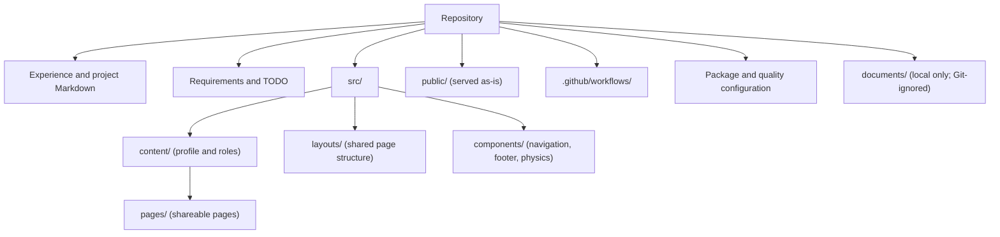

# Current Role Responsibilities

## Role Summary

I own the technical delivery and ongoing operation of Powerfleet's marketing websites and digital demand-generation systems. My work connects the website platform, campaign experiences, marketing automation, analytics, regional content, and lead-conversion workflows. I take projects from requirements and implementation through testing, release, monitoring, and documentation.

This is a working description inferred from the project documentation in this folder, not a formal company-issued job title or job description.

## Core Responsibilities

### Website and Platform Operations

- Build and maintain Joomla and YOOtheme websites, templates, child-theme overrides, modules, scripts, styles, and page-builder experiences.
- Deliver and support the main Powerfleet web estate, regional sites, campaign microsites, careers content, and supporting site utilities.
- Diagnose website, CMS, deployment, performance, and editor-workflow issues using reproducible tests and available logs.
- Maintain clear development-to-production controls: test changes in development, document evidence, preserve backups, and promote only reviewed changes.
- Coordinate hosting, CDN, DNS, and security-provider investigations when the cause lies outside the application; keep infrastructure changes with the responsible provider or administrator.

### Campaign Experiences and Lead Generation

- Build and support regional landing pages, PPC campaign pages, product and industry experiences, and interactive marketing content.
- Implement and maintain lead forms and multi-step workflows for demo requests, partner applications, referrals, customer support, careers, and incident reporting.
- Connect front-end experiences to Pardot forms and handlers, including field mappings, completion behavior, validation, regional routing, and UTM attribution.
- Develop interactive tools such as ROI and savings calculators, translating business requirements and approved assumptions into responsive, testable customer experiences.
- Maintain reusable campaign components and form utilities so new regional or product campaigns can follow established patterns.

### Marketing Automation and Data Capture

- Maintain the browser-side and server-side integrations that carry campaign and session context into form submissions.
- Preserve UTM and campaign parameters across pages and embedded forms, and support source, region, device, and referral attribution.
- Review lead-field requirements against existing CRM/Pardot fields before proposing schema changes; keep payloads and handler mappings aligned.
- Implement validation and submission safeguards, including reCAPTCHA and same-origin submission proxies where required.
- Protect personal and campaign data by limiting collection and persistence to the approved use case and avoiding exposure of credentials or sensitive session data.

### Analytics and Advertising Measurement

- Implement, test, and document Google Tag Manager and GA4 measurement for forms, resource downloads, video engagement, campaign interactions, and calculator submissions.
- Support conversion tracking across Google Ads and other advertising platforms, including event contracts, regional conversion actions, triggers, and tags.
- Validate that conversion events fire on successful outcomes, distinguish primary optimization signals from supporting reporting events, and investigate discrepancies across analytics and ad platforms.
- Maintain GTM maps and exports as auditable references, and coordinate measurement changes with campaign and agency stakeholders.
- Validate Salesforce/CRM conversion exports and prepare correctly structured files for advertising-platform imports.

### Regional Content, SEO, and Brand Transition

- Support market- and language-specific experiences, including country, currency, phone, routing, and translated-content behavior.
- Maintain regional language packs and legal-content inventories, page structures, menu associations, and publication checklists.
- Plan and validate legacy-domain migrations with approved, page-specific redirect mappings rather than speculative catch-all redirects.
- Audit URLs, redirects, tracker domains, crawlability, and related technical SEO behavior; document evidence and unresolved content decisions.
- Help migrate brand and content assets across platforms, including website video libraries and embedded media workflows.

### Privacy, Security, and Reliability

- Build privacy and consent requirements into forms, tracking, cookies, persistence, and campaign workflows, with GDPR and POPIA considered where applicable.
- Use backups, rollback references, environment separation, release notes, and focused regression checks to reduce production risk.
- Investigate security and availability incidents without making speculative production changes; preserve sanitized evidence and coordinate with the relevant security, hosting, or CDN provider.
- Keep secrets, personal information, raw logs, and sensitive exports out of tracked documentation and public repositories.

### Documentation and Operational Ownership

- Maintain repositories as practical sources of truth for implementation details, deployment steps, field mappings, testing, incidents, and open decisions.
- Turn ambiguous requests into scoped technical work, identify required business or legal approvals, and record what is verified versus pending.
- Own implementation and routine validation for the marketing systems represented here; involve agencies and external providers for findings, monitoring, or services they control.

## Representative Project Areas

These repositories illustrate the breadth of the role; they are examples, not a complete list of active services.

| Area | Representative repositories |
| --- | --- |
| Main website and platform operations | [powerfleet-cons](powerfleet-cons/README.md), [ytp-child-theme](ytp-child-theme/README.MD), [careers-powerfleet](careers-powerfleet/README.md), [mix-joomla](mix-joomla/README.md) |
| Calculators and conversion journeys | [roi-calculator-main-site](roi-calculator-main-site/README.MD), [roi-calculator-cnx](roi-calculator-cnx/README.MD), [sme-calculator](sme-calculator/README.MD) |
| Pardot, forms, and attribution | [pardot-form-scripts](pardot-form-scripts/README.md), [pardot-forms](pardot-forms/README.md), [analytics-storage-data](analytics-storage-data/README.md), [regional-sales-forms](regional-sales-forms/readme.md), [rmd-forms](rmd-forms/README.md) |
| Measurement and advertising | [powerfleet-gtm-map](powerfleet-gtm-map/README.MD), [advanced-conversion-tracking](advanced-conversion-tracking/README.md) |
| Regional campaigns and content | [mix-eu-lp](mix-eu-lp/README.md), [mix-global-gps-lp](mix-global-gps-lp/README.md), [mix-vision-standalone-za](mix-vision-standalone-za/README.md), [content-syndication](content-syndication/README.md) |
| Legal content, localization, and migration | [legal-pages-powerfleet](legal-pages-powerfleet/README.md), [language-region-packs](language-region-packs/README.md), [global-redirects](global-redirects/README.MD) |
| Reliability and media operations | [link-11-reblaze](link-11-reblaze/README.md), [vimeo-videos](vimeo-videos/README.MD) |
| Forms and supporting tools | [campaign-request-forms](campaign-request-forms/README.md), [partner-request-form-us](partner-request-form-us/README.md), [referral-link-generator](referral-link-generator/README.md), [cookie-modals](cookie-modals/README.md) |

## Scope Notes

The folder also contains legacy campaign builds, brief or placeholder READMEs, Joomla distributions, third-party assets, and experiments. Their presence is useful technical context but does not, by itself, establish that each is an actively maintained business responsibility. The core role above is based on recurring ownership patterns and the operational guidance documented across the project READMEs.

## Website project setup

The website is a minimal, static Astro starter. Its content and design are
placeholders; see [requirements.md](requirements.md) for the agreed baseline and
open decisions.

### Next: product and UI

Build a lightweight, interactive experience for recruiters and other potential
hirers, with shareable URLs and SPA-style navigation. Start with approved
content and a clear primary action, then develop the UI, browser-preferred light
and dark themes, and self-hosted typography. See [TODO.md](TODO.md) for the
product tasks and acceptance checks.

### Repository structure

The existing Markdown files describe experience and provide project context.
They are reference material, not automatically published website content; the
role description at the top of this README predates the CV update and may be
out of date. Published content lives in `src/content/` (see "Content and CV"
below). The home, experience, and skills pages are built from it; the about page
is still a placeholder.

```text
.
├── README.MD                 Project context and setup
├── responsibilities.md       Experience reference
├── requirements.md           Product and quality requirements
├── TODO.md                   Product and UI tasks
├── inspiration.md, stack.md  Design and technology references
├── astro.config.mjs          Production URL and URL format
├── src/content.config.ts     Content schema (roles, profile and recommendations)
├── src/content/              Website content: profile, one file per role, recommendations
├── src/lib/                  Content helpers (sorting, dates, platforms)
├── src/pages/                Home, about, experience, skills, downloads, and 404 pages
├── src/layouts/              Shared page structure and client navigation
├── src/components/           Header, navigation, roles, recommendations, Get in touch, footer, CV download, physics placeholder
├── public/                   Files served as-is (third-party license notices)
├── tests/                    Generated-page checks
├── .github/workflows/        Quality checks and deployment
├── package.json              Scripts and dependencies
├── documents/                Local reference files; ignored by Git
└── screenshot/               Local setup screenshots (for example block-users/); ignored by Git
```



As the site grows, use the following structure. `pages/`, `layouts/`,
`components/`, `content/`, and `public/` exist; the other folders are
**proposed** and should be created only when needed:

```text
src/
├── pages/        Site entry points
├── components/   Reusable UI and interactive components
├── layouts/      Shared page structure
├── content/      Approved website content
├── styles/       Shared styles and theme tokens
└── assets/       Images and other assets processed by Astro
public/           Assets served as-is, such as self-hosted fonts
```

Start by reviewing the existing Markdown and selecting what is suitable for the
site. Keep approved content separate from UI where practical. The content format
or source can change later; do not assume every repository Markdown file should
be published or introduce a content service until it is needed.

### Content and CV

The site's career content is structured like a CV and checked at build time
against the schema in [src/content.config.ts](src/content.config.ts); a missing
or misspelled field fails the build.

- **Positioning:** [src/content/profile.json](src/content/profile.json) holds the
  name (the header logo's link text and the small line above each page's `h1`), the title (the home page `h1`,
  "Technical Marketing Developer"), the headline (the home page lead),
  the summary (the home page About section: a photo placeholder on the left
  from 768 px, a larger "About" h2 (32–48 px), the summary at lead size and a
  "Full Bio" link to the About page; replace the placeholder in
  `src/components/AboutSummary.astro` with an `` with alt text), and focus areas (website development, CRM integration, and technical
  SEO). The site presents a technical website developer in a marketing
  department, focused on those three areas; design work and design tools are
  left out unless they support them.
- **Roles:** one Markdown file per role in
  [src/content/roles/](src/content/roles/). Each role lists its areas of
  responsibility, and each area lists the platforms used. The Experience page
  shows roles oldest first; the Skills page lists every platform with the areas
  that use it, in the order they first appear. List the most relevant areas and
  platforms first. The page reads as a timeline
  (`src/components/Timeline.astro`, one page section): each role is a chapter
  (`src/components/RoleEntry.astro`), starting with the first role and
  working up to the current one (no `end`). The current role's summary is shown
  once, in the hero under the lead, instead of in its chapter. See
  "Experience timeline" below.
- **Recommendations:** [src/content/recommendations.json](src/content/recommendations.json)
  holds quotes with the person's name, title, optional company and
  relationship, shown in that order by the reusable
  `src/components/Recommendations.astro` (props: `id`, `heading`, `limit`).
  It is on the Experience page after the timeline, with
  its own "Recommendations" link in the on-page navigation; with no entries it
  renders nothing and the link is left out. Entries with `"placeholder": true`
  get a dashed border and a "Placeholder" label; the current three are
  placeholders until real recommendations are added.
- **Sources:** the content was last balanced (2026-11-26) between the earlier
  CV and the LinkedIn basic profile export, both kept in the git-ignored
  `documents/` folder. Personal details from the CV (ID number, date of birth,
  home address) are never published.
- **Contact:** `contact.email` and `contact.phone` in the profile feed the
  "Get in touch" section (see below). Update them there, for example when the
  site's own domain email is ready.
- **CV downloads:** the profile's `cv` list names each version, currently
  `/cv/dennis-ferreira-cv.pdf` (PDF) and `/cv/dennis-ferreira-cv.docx` (Word).
  The Downloads page (`/downloads/`) lists them all; a version shows "Coming
  soon" until its file is added to `public/cv/` with that name, then becomes a
  download link with its format and size. Once any version exists, a "Download
  my CV" link to the Downloads page also appears on the home, about, and
  experience pages. The CV is public: leave out your home address, ID number,
  and anything you would not post online.

To add a role from the earlier CV, create a file such as
`src/content/roles/previous-company.md`:

```md
---
title: Job title
department: Marketing department   # optional
company: Company name
companyNote: Any rename or merger   # optional
merger:                             # optional: shown as a branch on the timeline
  from: Earlier company name
  on: '2024-04'                     # when it became `company`
start: '2014-03'                    # 'YYYY' or 'YYYY-MM'
end: '2017-09'                      # leave out for the current role
summary: >-
  One or two sentences on the role's purpose.
areas:
  - title: Area of responsibility
    accent: seo   # optional: operations, campaigns, automation, analytics, seo, documentation
    summary: >-
      What you delivered and the result.
    platforms:
      - Platform name
---
```

Checks (2026-11-24; live since [this workflow run](https://github.com/6210/dfpf-26-27/actions/runs/45385071984)): build, page tests, and Lighthouse
passed on every page (performance 100, accessibility 100, no layout shift).
A test CV file produced download links on the home, about, and experience
pages, and removing the file stopped the build with a clear error. Pages were
checked in Chrome at 360 px in both themes, with no horizontal scrolling or
console errors.

### How the site is built and deployed

```mermaid
flowchart LR
    Docs["Existing Markdown and CV<br/>experience references"]
    Review["Review and update<br/>content"]
    Content["src/content/<br/>profile and roles"]
    Page["Astro pages"]
    Build["Astro static build"]
    Checks["Page tests and<br/>Lighthouse quality checks"]
    Deploy["Cloudflare Pages"]
    Site["Recruiters and<br/>potential hirers"]

    Docs -.-> Review
    Review -.-> Content
    Content --> Page
    Page --> Build --> Checks --> Deploy --> Site
```



Dotted lines are manual editing steps; solid lines are automated. For a push to
`main`, GitHub Actions runs the build and checks before deploying. The diagram
renders on GitHub and in Markdown viewers with Mermaid support; it does not add
a library or runtime request to the website.

### Local development

Use Node.js 22.23.4 or newer on a supported even-numbered release (the version
is pinned in [.node-version](.node-version)). On this Mac, Homebrew's `node@22`
is linked as the default `node`; check with `node -v`. Then run:

```sh
npm ci
npm run dev
```

The dev server starts in about a second at <http://localhost:4321/> and
reloads the page as soon as a file is saved, with no build, commit, or deploy.
Astro's dev toolbar appears at the bottom of the page in dev mode only; hide it
from its Settings button if it gets in the way.

| Command | Use it to |
|---|---|
| `npm run dev` | Work locally with live reload, on this computer only. |
| `npm run dev:lan` | Same, but also reachable from a phone or iPad on the same Wi-Fi at the Network address it prints (for example `http://192.168.0.102:4321/`). Use it on trusted networks only. |
| `npm run check` | Build the production site into `dist/` and run the page tests. |
| `npm run preview` | Serve the production build from `dist/` at <http://localhost:4321/>. |
| `npm run quality` | Run Lighthouse against the production build (needs Chrome). |

Dev mode does not minify CSS or bundle scripts the way the production build
does, and some issues only show up after minifying (the scroll-reveal
`animation` shorthand bug was one). Before making changes live, run
`npm run check`, look at the result with `npm run preview`, and run
`npm run quality`.

Changes are tested locally and only committed and pushed when they are ready to
go live; every push to `main` runs the CI checks and deploys, which takes
several minutes.

### Layout and breakpoints

The layout is fluid: sizes grow smoothly with the screen instead of jumping at
many breakpoints (the approach recommended by [Utopia](https://utopia.fyi/) and
web.dev's [macro layouts](https://web.dev/learn/design/macro-layouts)). Tokens
in `:root` in `SiteLayout.astro`:

- `--page-max: 100rem` (1600 px): the widest the content gets.
- `--gutter: clamp(1.5rem, 4vw, 5rem)`: side space, from 24 px on phones to
  80 px on large screens.
- `--page-inset`: the gutter, or more on screens wider than `--page-max`, so
  content stays centred. The header and the `.page` wrapper both use it, so the
  name and buttons line up with the content edges.
- `--measure: 70ch`: paragraphs and list items in `main` stop at a readable line
  length, while headings, grids and animations use the full width.
- `--section-space: clamp(4rem, 12svh, 9rem)`: space between sections, split
  as padding above and below each one.
- `--row-gap: clamp(2rem, 3vw, 3rem)` and `--column-gap: clamp(2rem, 4vw,
  4.5rem)`: gaps in card and platform grids.
- `--aside-space`: 0 on phones and tablets, 150 px (`9.375rem`) from 1024 px.
  `main` reserves it on the right for a future side element.

Every direct child of `main` is a section (a test checks that each page starts
with `<main><section><h1>`, allowing one wrapper around the hero text).

Each page opens with a hero from `src/components/PageHero.astro`: the h1,
lead and links on the left, and the page's animation on the right
from 1024 px (text about 60% of the width, both centred vertically). Below
1024 px the animation sits under the text. The homepage supplies `HeroGraph`
through the named `animation` slot; other animated heroes retain their physics
placeholder. Downloads and the 404 page use the
same hero without a placeholder. An optional `eyebrow` adds a smaller line
above the title inside the h1. Every page except the 404 uses the profile
name, so headings read, for example, "Dennis Ferreira Experience" or
"Dennis Ferreira Skills" for search engines and screen
readers (a test checks each page). The eyebrow uses the body font at weight 300 (only the
bold heading font is loaded), in capitals via CSS (the HTML keeps normal
case), 15–18 px with 0.12em letter spacing and 20–32 px below it. It is coral in dark mode and the text
colour in light mode (coral on white is too low in contrast for small text). Each one is at least `80svh` tall, with its
content centred vertically. Paragraphs and list items use a 1.6 line height,
and headings use 1.2.

#### Scroll reveal

Content slides up and fades in as it scrolls into view. This is a CSS
scroll-driven animation (`animation-timeline: view()`), with no JavaScript.
Sections themselves never move, so in-page links and the scroll spy land in
exactly the right place; only their children animate. Inside a section, items
with the `.reveal` class animate one by one (role headers, responsibility
cards, recommendations, platforms). Browsers without scroll-driven animations
(currently Firefox), and visitors who prefer reduced motion, see the content
without animation. The rule uses longhand `animation-*` properties, because
the CSS minifier would otherwise fold `view()` into an `animation` shorthand
that browsers reject.

#### Experience timeline

The roles on the Experience page form one horizontal timeline, oldest first,
in a single pinned view (`position: sticky`) on screens at least 48rem (768 px)
wide and 40rem (640 px) tall. Nothing in it moves vertically:

- The role's year, large and in the text colour, with the company name to its
  right, sits above a year axis across the full width. The year counts up as
  the role goes by, reaching the next stop's year as the line gets there
  (a registered `@property --year` integer animated by the scroll and shown
  with a CSS counter; without support it shows the start year). At the right
  end of that row, "XX Years Experience" counts up the same way from 0 at the
  first stop (16 by 2026), saying "Year" at 1 through a container style
  query; it is shown only with the timeline. The axis has a stop for each role's start year and ends at
  the current year (taken at build time, so a yearly rebuild keeps it right)
  while the last role is ongoing. Stops are spaced to scale by year, so
  longer roles take up more of the line, but every segment gets at least a
  tenth of it so neighbouring years stay readable on narrow screens. The
  counted year, the line and any merger branch use the same scale, so they
  stay in step. The current role's year is bold, stops already
  reached are filled with the accent colour, and the line fills from the
  current stop to the next as the role goes by. When the line reaches the
  end, the last role holds for one more step: the end stop fills and becomes
  the bold one, and the year above the axis has counted up to the end year.
  The current stop's dot is 1.5 times larger, and dots grow slightly on hover.
  A role with a `merger` adds an unlabelled branch: at the merger date
  (placed by year, so the counted year reaches it at the same moment) a line
  leaves the axis, drops below it and runs on to the end. Until the line
  passes that point the heading shows the earlier company name, then it
  switches to `company` and the branch fills with the accent colour. The
  branch is drawn on every role's axis (muted before it is reached) so the
  axis height never changes; it is decorative, and `companyNote` carries the
  merger for screen readers and the no-JS layout.
  The stops don't snap: over the last stretch of a role (`--fade`, 12svh of
  scrolling) the next dot fills and grows as the current one shrinks and its
  year turns bold, driven by the scroll alone, so the next role's axis takes
  over exactly where this one left off. The end stop does the same once the
  last role's line reaches it. The content itself never fades or moves on
  its own, and the view sits at a fixed distance from the top (not centred)
  so the year, company and axis stay at the same height in every role.
  Each stop (dot and year) links to its role, and the end stop to the point
  where the timeline is complete, with the site's smooth scroll. The axis is
  a mouse shortcut: it is hidden from screen readers (`aria-hidden`) and its
  links are out of the tab order (`tabindex="-1"`), since every role repeats
  it; the dates are in each role's text and the roles are reachable by
  heading. Only the role showing takes clicks: roles overlap, so the role
  boxes ignore the pointer and hidden roles are `visibility: hidden`.
- Below the axis, the left column holds the role's title, department and
  dates. It,
  and the year, stay still and change at once to the next role when the
  previous role's last responsibility has left.
- The right column shows the role's responsibilities, one card wide, sliding
  to the left at a steady pace as you scroll, with no pauses: each role starts
  with its first responsibility in place and ends with its last one in place,
  and the next role takes over with its own first responsibility in place, so
  the column is never empty. A role with a single responsibility stays still
  for a short stretch (30% of the screen height). The cards and the axis
  line ease after the scroll (a 0.6s ease-out transition) instead of moving
  in hard steps with each wheel notch, and settle when scrolling stops.

The roles sit in one page section, `Timeline.astro` (`#timeline`), listed once
in the on-page navigation as "Timeline"; its link lands where the first role
pins. How it works: each role is its own tall block with a named view timeline
(`view-timeline: --role`, with `view-timeline-inset: 0` so it ignores the
header's scroll padding). Consecutive roles overlap by one screen height
(`margin-block-start: -100svh`), so the next role pins exactly as the previous
one lets go, and each role's view is only visible during its own turn. The
scroll animates a registered `--progress` number (0 to 1 through the role) on
the view; the cards' `translate` and the line's `scale` are calculated from it
with the role's number of moves (`--moves`) and carry a CSS transition, so
they glide to each new scroll position. Positions use container query units (`100cqi`, the width of the right
column), so no JavaScript measures anything. Each role's height grows with its
responsibilities (`--units` × `--unit`, 40% of the screen height per card). In-page links land where a role pins
(`scroll-margin-block-start: -6rem` cancels the header space). The area badge
ignores responsibilities that are out of sight sideways (`data-morph-clip`).
Phones, shorter windows, reduced motion, print and browsers without
scroll-driven animations (currently Firefox) show each role with its
responsibilities in the normal grid instead.

The physics stage in the hero keeps a 4:3 shape at every width (elsewhere it
would be `clamp(16rem, 50svh, 40rem)` tall). The Experience
responsibilities use a grid with `minmax(min(100%, 24rem), 1fr)` columns: one
column on phones, two from about 1024 px, three from about 1440 px.

| Breakpoint | Typical screens | What changes |
| --- | --- | --- |
| below 48rem (768 px) | Phones | Two-row header, smaller h1 and `.lead` |
| 48rem (768 px) | Tablets | One-row header with the centred scroll spy |
| 64rem (1024 px) | Large tablets, small laptops | Theme toggle moves from the menu to the header; 150 px reserved on the right of `main`; with a mouse or trackpad, the on-page links move to the section rail on the right |
| fluid up to 100rem (1600 px) | 1366–1920 px laptops and monitors | Gutter and content width grow |
| above 100rem | 2560 px and ultrawide (3440 px) | Content stays 1600 px wide and centred |

The most common desktop sizes (StatCounter, November 2025 to October 2026) are
1920×1080 (21%), 1536×864 (7.9%), 1366×768 (6.3%), 1280×720, 2560×1440 and
1440×900, so the fluid range covers them. On a 13-inch MacBook Pro (about
1440 px) the content is about 1325 px wide. Ultrawide tuning is still to be
tested on a real screen.

### Navigation and search

Astro generates separate HTML pages for `/`, `/about/`, `/experience/`,
`/skills/`, and `/downloads/`. To add a page, create it in `src/pages/` using `SiteLayout` and add
it to the list in `src/components/SiteNav.astro`.
Its built-in client router provides SPA-style navigation when JavaScript is
available; ordinary links still work without it. The generated `404.html`
supplies a not-found page.

The navigation links are defined once in `src/components/SiteNav.astro` and
used by the header menu and the footer. The current
page's item is shown as plain, emphasized text with `aria-current="page"`
rather than a link, so it cannot be clicked again and is skipped when tabbing.

#### Header

`src/components/SiteHeader.astro` holds, from left to right:

- **Logo**: the DF monogram (`src/components/LogoMark.astro`, 36px), drawn
  inline in the text colour so it switches with the site's theme (near-black
  in light mode, near-white in dark). The SVG is decorative (`aria-hidden`);
  the name "Dennis Ferreira" (the `name` field in `src/content/profile.json`)
  stays beside it as visually hidden text, so the link is named for screen
  readers and the name stays crawlable text for search engines. It links home,
  except on the home page.
- **Favicons and app icons** (in `public/`): `favicon.svg` is the same mark and
  follows the visitor's system theme; `favicon.ico` (32px),
  `apple-touch-icon.png` (180px) and the `site.webmanifest` icons (192px,
  512px, and a 512px maskable version with extra padding) show the dark mark
  on white, because raster icons cannot change with the theme. After editing
  `favicon.svg`, run `node scripts/make-icons.mjs` to regenerate them (it uses
  `sharp`, which Astro already installs). Keep `LogoMark.astro` in step with
  `favicon.svg`.
- **On this page** (centred): a scroll spy listing the page's sections. Each
  page passes `sections` (an `id` and short `label` each) to `SiteLayout`; the
  ids must exist on the page, which a page test checks. Labels never name an
  employer: on Experience the whole timeline is a single "Timeline"
  link, followed by "Recommendations", so other sections can be added
  around it. As the visitor scrolls,
  the section whose top has reached the area below the header is marked with
  `aria-current="location"` and full-strength text (other links are slightly
  muted), and a single gradient underline slides across to it. Pages
  without `sections`, such as 404, leave it out. Below 48rem (768 px) it moves
  to a second row and scrolls sideways if needed, keeping the current link in
  view. On large screens with a mouse or trackpad it is replaced by the
  section rail (below).
- **Section rail** (from 64rem / 1024 px, only when the main input can hover
  and point precisely: `(hover: hover) and (pointer: fine)`, so iPads and
  phones keep the header links): the same links in a column fixed at the
  centre right of the screen. Each one is a dot on a short line that runs to
  the screen edge. For the current section the line stretches out (with the
  accent colour) and its label slides in to the left of the dot; leaving
  sections retract the same way. Hovering or focusing any dot shows its label,
  and every dot is a link with the same smooth scroll as the header links.
  The rail is a separate `<nav data-rail>` after the `<header>`, because the
  header hides by sliding up with a transform, which would carry a fixed child
  with it. Only one of the two navs is ever displayed, so screen readers meet
  one "On this page" list; both run the same scroll spy script, and the rail
  is made inert while the full-screen menu is open. The active line is 3rem
  long so the longest label ("Recommendations") still clears the content at
  1024 px; keep labels about that length or shorter. The design is a draft
  based on a sketch.
- **Theme toggle** (from 64rem / 1024 px wide, i.e. larger than an iPad), then a **menu button** (hamburger, placeholder styling)
  that opens the page navigation full screen. A light veil and a 12 px blur
  keep the page behind recognisable in both themes (the light theme gets a
  thinner veil, because a white wash hides more). The veil is solid when the
  browser cannot blur or the visitor prefers reduced transparency. Links are
  centred in the heading font; on hover, keyboard focus, and the current page
  they brighten and the gradient underline grows from the centre. On opening,
  the veil fades in as the blur deepens and the links rise into place, unblurring,
  one after another; on closing they fade away together. None of this animates for
  visitors who prefer reduced motion. Because the menu covers the hamburger, it
  has its own close button: an X about 8px from the top-right corner. The
  theme toggle, menu button and close X are bare 32px icons with no border or
  padding (each a 32px tap target); a keyboard focus ring still appears around
  them. Below 64rem (1024 px; phones and iPads) the theme
  toggle is not in the header; it moves into the menu, below the links, and rises in last; wider
  screens keep it in the header and leave it out of the menu.
  The menu uses the HTML Popover API, so it opens and closes with the buttons
  or Escape and returns focus to the menu button without JavaScript. With
  JavaScript, focus moves to the close button and stays in the menu, because
  the page behind is made inert. The page does not scroll while the menu is
  open.

The header is sticky: it slides out of view while scrolling down and returns on
any scroll up. On large screens with a mouse or trackpad (the same breakpoint as
the section rail) it has no background, so the page and dot grid show behind
it; the theme toggle and menu button stay fixed in the top-right corner, and
only the logo slides away on scroll down. Clicks on the empty
part of the header reach the page below. iPads and phones keep the solid bar
that slides away as a whole. It stays visible while it has keyboard focus or the menu is open,
and slides without animation for visitors who prefer reduced motion. Without
JavaScript it simply stays at the top and the section links are ordinary
in-page links. `scroll-padding-top` keeps linked sections clear of the header.
A thin coral line fixed along the very top of the screen shows how far down the
page the visitor has read. It sits outside the header, so it stays visible on
every page and screen size even while the header is hidden.

**Smooth scrolling.** Clicking any link to a section on the same page (in the
header or anywhere in the content) glides there with a gentle ease-in-out
curve. Longer trips take a little longer, between 0.45 and 1.1 seconds. While
it moves, the header stays visible and the underline travels through each
section it passes. Scrolling, touching, clicking, or pressing a key stops the
glide and hands control back at once. The address bar, Back and Forward, and
keyboard focus behave exactly as for an ordinary link: the script lets Astro's
client router record the move, then animates to the position the browser chose.
Visitors who prefer reduced motion jump straight there. Without JavaScript, CSS
`scroll-behavior: smooth` gives a plain smooth scroll, also only when motion is
allowed.

**Page transitions.** Moving to another page keeps the header in place while
the content and footer change: going forward, the old page accelerates up and
away fast (0.3 s, travelling 10rem) while blurring, and the new one snaps in from well below and
settles (0.7 s, from 14rem); going Back, both move downward instead. Both are slightly
blurred and smaller while faded. Only position, size, opacity, and blur
animate, and only on client-side navigation, so the first page load and what
search engines see are unaffected.
`pageFade` in `SiteLayout.astro` defines this with Astro's view transitions,
and the `page-fade-*` keyframes sit in its global styles. Links to sections on
the same page do not fade; they smooth-scroll as above. Visitors who prefer
reduced motion get an instant swap.

The accent colour (see "Accent colour" below) is used for links, the
current-section underline, the reading-progress line and the section rail. In
forced-colours mode these fall back to system colours.

Header checks (2026-11-24, local, not yet deployed): build, page tests, and
Lighthouse passed on every page (performance 100, accessibility 100,
under 40 KB of script). Browser checks covered the forward (fade up) and Back
(fade down) page transitions, the scroll spy while scrolling and after
clicking section links; hiding the header on scroll down and showing it on
scroll up; opening the full-screen menu by mouse and keyboard, focus moving to
the close button and staying in the menu, the page keeping its scroll position,
and closing with the close button and on client navigation; light and dark
themes; and the one-row layout at 1280 px and the two-row layout at 360 px
without horizontal scrolling. Closing
the menu with Escape could not be confirmed: the test browser blocks Escape for
every popover, including on a bare test page. Check it in a desktop browser.

Smooth-scroll checks (local, not yet deployed, with the pages temporarily
padded to be long): build, page tests, and Lighthouse passed on every page
(performance 100, accessibility 100, at most about 38 KB of script). Browser
checks covered gliding by mouse and keyboard, the underline travelling during the
glide, stopping on wheel input, the reduced-motion jump, Back and Forward
restoring each position, and Tab continuing from the target section.

#### Get in touch

`src/components/GetInTouch.astro` closes every page's main content, just above
the footer, with the email address and phone number from the profile as
clickable email and call links. Pages with on-page links also get a "Contact"
link in the header's scroll spy.

The owner approved publishing both details (2026-11-24) with light spam
protection that does not get in visitors' way. The built HTML holds each value
only reversed and base64-encoded, and a few lines of script turn it into a
normal link on load and after client navigation. Without JavaScript, visitors
read "name at gmail dot com" and the phone number as text; a hidden decoy in
each (not shown, copied, or read aloud) spoils the copy that simple scrapers
extract. This stops casual harvesting, not a determined scraper that runs
JavaScript. The plain values are in `src/content/profile.json`, so they are
also visible in the repository. A page test checks that neither appears as
plain text in any built page.

Checks (2026-11-24, local, not yet deployed): build, page tests, and Lighthouse
passed on every page, including Downloads (performance 100, accessibility 100).
Browser checks covered the decoded links on load and after client navigation,
the no-JavaScript text, the Downloads page with no CV files and with a test PDF,
and the 360 px layout without horizontal scrolling. Calling and emailing from
a phone were not tested.

`src/components/SiteFooter.astro` appears on every page through the shared
layout. It repeats the navigation and shows the year, Gqeberha, South Africa,
and South Africa Standard Time (SAST, UTC+2). The year is set when the site is
built, so it updates on the first deployment of a new year.

Each placeholder page has its own title, description, and canonical URL, but is
temporarily marked `noindex`: it is not ready to appear in search results.
Approve real content before removing that instruction and creating a sitemap.
The canonical origin is currently `https://dfpf-26-27.pages.dev`; update
`astro.config.mjs` if the production domain changes.

Local implementation checks: the build, generated-page tests, and Lighthouse
checks passed. Browser checks covered client navigation and history, direct
loading, navigation without JavaScript, and widths of 360 px and 1280 px.
Deployed 2026-11-24 via the
[quality-checked workflow](https://github.com/6210/dfpf-26-27/actions/runs/45345512289):
`/` and `/experience/` return 200, and unknown URLs return the 404 page with a
404 status on Cloudflare Pages.

### Light and dark theme

The site starts in the visitor's system light or dark preference. The theme
button (`src/components/ThemeToggle.astro`; in the header from 1024px wide, at
the bottom of the menu on phones and tablets) shows an animated icon adapted
from the toggles.dev "Spin" toggle (MIT), drawn as outlines: a sun with eight
rays in the light theme; going dark, the rays spin away while the sun grows and
a sliding bite turns it into an outlined crescent moon. It is an
inline SVG animated with CSS only (0.6 s with a slight bounce, off for reduced motion), with a
static fallback in browsers that cannot animate SVG paths with CSS. In the
header it is icon-only, with a small hint ("Switch to dark mode") that appears
below it on mouse hover or keyboard focus; in the menu the text sits beside it.
Its name, shown or read aloud, is the action: **Switch to dark mode** while the
site is light and **Switch to light mode** while it is dark. The choice is saved in the
browser's `localStorage` and applies across pages and later visits. A small
inline script in the page head sets the theme before content appears, so there
is no flash of the wrong theme. Without JavaScript, the site follows the system
preference and the button is hidden. Colors use CSS `light-dark()` with
placeholder values until the visual design is chosen.

Switching themes fades colors over 1.5 seconds (the `--theme-fade` token in
`SiteLayout.astro`, shared by every theme transition) instead of changing them
instantly. After a click, a short message ("Dark mode on" or "Light mode on")
appears near the top right for about 2.6 seconds, shown as a popover so it
sits above the open menu, and the same text is announced to screen readers
through a hidden status region. The fade and the message's slide-in are turned
off for visitors who prefer reduced motion. The
button label is chosen with CSS from the theme set in the page head, so the
button does not appear late or shift the page when it loads.

Local checks (2026-11-24): build, page tests, and Lighthouse passed
(accessibility 100). Browser checks covered light and dark preferences,
toggling by mouse and keyboard, persistence across client navigation, back
navigation, and reload, and a 360 px width. Live following of a system
preference change could not be confirmed in the test browser; check it on a
real device.

Skills page and navigation update (2026-11-24, deployed in
[this workflow run](https://github.com/6210/dfpf-26-27/actions/runs/45350501851)): build, page
tests, and Lighthouse passed for all four pages. Browser checks confirmed the
current nav item is not a link on each page, the theme button label switches
between **Dark mode** and **Light mode**, and the layout fits at 360 px. Page
transition errors appeared only in a hidden test tab, where browsers cancel
view transitions; a visible Chrome session showed none. A missing favicon
returned 404 at the time (since added).

Footer update (2026-11-24): build, page tests, and Lighthouse passed for all
pages. Browser checks covered footer navigation and current-page state after
client navigation, dark mode, and a 360 px width. The footer and About page
were deployed in
[this workflow run](https://github.com/6210/dfpf-26-27/actions/runs/45363526471).

### Accent colour

The site uses one accent colour in both themes,
[Pantone 16-1546 TCX](https://www.pantone.com/color-finder/16-1546-tcx)
(`#ee7869`, coral). It replaced a Pantone yellow, which in turn replaced six
per-area colours and a multicolour gradient. The tokens are in
[src/layouts/SiteLayout.astro](src/layouts/SiteLayout.astro):

- `--color-accent: #ee7869`, used for lines, dots, icons, underlines and the
  physics test shapes, in both themes.
- `--color-link: light-dark(var(--color-text), var(--color-accent))`. Links
  are coral text in dark mode; in light mode they use the normal text colour
  with a coral underline, because coral text on white is too faint. The site
  name in the header always uses the text colour (near-white in dark mode).
  Selected text has a coral background with near-black text (about 6.8:1)
  in both themes.

| Theme | Use | Background | Contrast | WCAG AA (4.5:1 text, 3:1 UI) |
|---|---|---|---|---|
| Dark | Coral text, lines and icons | `#121212` | 6.7:1 | Passes |
| Light | Coral lines, dots and icons | `#ffffff` | 2.8:1 | Below 3:1, accepted as decoration; meaning never relies on it |
| Light | Link text (text colour, coral underline) | `#ffffff` | Text colour | Passes |

Dark text (`#1a1a1a`) on coral is 6.2:1, so coral can also be used as a fill
behind dark text in either theme.

Areas of work still carry a `data-accent` key (for example `campaigns`), but it
now only chooses the area's icon; every area uses the same colour. Areas are
told apart by their headings and icons, never by colour.

### Dot grid background

A faint dot grid sits behind every page, fixed to the screen so the content
scrolls over it. With a mouse or trackpad, the dots near the cursor brighten
like a soft spotlight and spring away from it, then settle back and fade with a
slight bounce once it moves on. It's in
[src/components/DotGrid.astro](src/components/DotGrid.astro) and added once in
the layout, and it stays in place between pages.

- Each hero/intro has a page-colour backdrop masked from 98% coverage at the
  top to transparent at its bottom. It makes the grid almost invisible behind
  the intro and restores its normal styling by the next section. The backdrop
  is behind the hero content and neutral scatter dots, follows the theme fade,
  and works without JavaScript or motion; the grid itself is unchanged.
- Dots are 2px across and 18px apart. Away from the cursor, and everywhere on
  first load, they are faint: 30% of the full dot colour, so they read as
  texture and do not distract.
- The full dot colour, used only near the cursor, is the text colour at 32%
  opacity in dark mode and 50% in light mode (small dots read fainter on
  white).
- Dots within 200px of the cursor brighten towards the full colour, the
  nearest most. Dots within 110px are also pushed away, up to 20px each.
- Without JavaScript, on touch screens (no cursor), and with reduced motion,
  the same faint grid is drawn by CSS and does not move or brighten. It is
  hidden in forced-colours mode and when printing.
- With a cursor, a canvas draws the grid. Only the dots near the cursor are
  redrawn, and it stops redrawing once they have settled, so it costs nothing
  while the mouse is still.
- The grid redraws whenever its colour fades (a theme change, or the saved
  theme being applied just after the page loads), so it always ends in the
  right colour.
- To tune it, change `spacing`, `reach`, `push`, `glowReach`, `faint`,
  `stiffness`, `damping` and `glowEase` at the top of the script (keep
  `spacing` equal to the CSS `--dot-spacing`, and `faint` to the share in
  `--dot-faint`), or the opacities in the `color` rule.
- The dots behind the text are softer: a left-to-right `mask-image` on the
  grid keeps them at 40% strength across the left quarter of the screen,
  rising to full strength at 55%. It only changes the dots' opacity, so there
  is no coloured layer and it works in both themes. Change the percentages in
  the `.dot-grid` `mask-image` to tune it.
- On large screens with a mouse the header has no background, so the grid
  shows behind it; on iPads and phones the header bar covers it.

### Area icons and morphing badge (test)

An interactivity test that links Skills to Experience by icon. Each
area of work has an icon from [Phosphor Icons](https://phosphoricons.com)
("regular" outline weight, MIT) in the accent colour. Outline icons are
preferred across the site over solid ones. The icon paths are copied into
[src/lib/area-icons.ts](src/lib/area-icons.ts), which also defines the list of
accents used by the content schema, so a new accent needs an icon.

- `AreaIcon.astro` draws an area's icon. Skills shows the icons of every area a platform is used in (for
  example Google Tag Manager gets the Analytics icon).
- `AreaBadge.astro` is a small badge fixed to the bottom right (with the area
  name from 768 px). It follows the area in view: as you scroll or hover an
  area card (Experience) or a platform (Skills), the icon morphs into the next
  area's icon with [flubber](https://github.com/veltman/flubber). The badge persists across page changes, so moving
  between Experience and Skills morphs it too. It hides on pages with no areas.
- Targets are any element in `<main>` with `data-morph="<accent>"` and
  `data-morph-label="<area title>"`.
- flubber (about 18 KB gzipped) is loaded only for the first animated morph.
  With reduced motion the icon changes without animation; without JavaScript
  the badge stays hidden and the static icons still show.
- The badge is decorative (`aria-hidden`); the area names are in the content.

Checks (2026-11-25): build, page tests, and Lighthouse passed. In Chrome at
1440 px the badge morphed on scroll, hover, and Experience → Skills
navigation; at 360 and 768 px there was no horizontal scrolling.

### Homepage node graph prototype

The homepage alone uses `src/components/HeroGraph.astro`, with original paired
strokes in `src/lib/hero-graph.ts`. Each stroke is sampled into individual dots;
the same 27 accent SVG circles move between a growth arrow and code
brackets/slash. Shape-specific connections keep the arrow continuous without
introducing cross-links in the code icon; their visibility interpolates during
the morph. There is no browser frame, chart axis, or bar.
A dense, irregular cluster of 192 neutral SVG dots sits close to
the icons, with 136 outliers across the intro. The original 64 remain
distributed across the hero; another 72 fill the lighter areas above,
below, and to the right of the main icon. These include 24 larger
6–7.5 px base-size dots, alongside the existing small and medium sizes;
outer dots scale by 1.8 on desktop.
All participate in the same collision layout, including accent separation.
Most clustered dots are
sampled near either icon; the remainder loosen the boundary without a spherical
distribution. Independent depth varies size and brightness.
Gentle drift, parallax, and cursor response share the graph's frame clock;
the stars sit behind the content and do not intercept input. Neutral dots repel
from the mouse and keep clear of the moving accent nodes and one another.
One collision layout separates every accent, local neutral, and outer neutral
circle in CSS-pixel coordinates, with a 3 px surface gap. Larger accent anchors
take priority; all dots retain their size and identity. The static SVG is also
collision-separated. Intro-wide outliers become visible only after the first
layout so there is no overlapping first frame; without JavaScript the complete
icon and dense local constellation remain visible.
Near the mouse,
faint temporary lines connect neutral dots rather than spawning new dots.
A fixed pool caps these at 32 lines, with at most two connections per dot.
Both endpoints must be within 140 CSS px of the cursor and less than 80 CSS px
apart. Connections fade with distance and disappear on leave, pause, reduced
motion, or when the intro or tab is hidden. A `ResizeObserver` keeps the
intro-wide overlay aligned with both the local SVG dots and outer stars.
Accent-node sizes peak at the marketing arrowhead and the development icon's
central slash midpoint and both bracket corners, tapering adjacent dots smaller.
The left bracket's upper arm and right bracket's lower arm each extend towards
the centre with an additional connected endpoint, not rings or cross-links.
Both full extended arms have matching lengths and evenly spaced dots on a
straight line. The code nodes share one depth plane, preserving straightness
under perspective; accent idle drift translates the whole icon rather than
bending its strokes. Mouse attraction and collision separation remain active.
These same extra nodes take distinct positions along the arrow's existing
strokes rather than stacking on other dots. The rising shaft also leaves
room for the separate bend and arrowhead nodes.
The bottom-left arrow start is not emphasized. Existing dots are redistributed
over full connected paths, with one centre-to-centre spacing throughout each
target, rather than inserting closer dots at the start or arrowhead ends.
This keeps the approved organic large/small pattern independent of spacing;
it does not impose a new size ramp. Both targets share a flat depth plane
so resting spacing is not distorted by curved depth. The arrowhead retains
its extended arms. The final rising shaft grows progressively
larger towards the fixed arrowhead tip. The overall layout position is
unchanged. Node radii morph alongside coordinates, with
restrained perspective.
Accent connections and context-nav marks share `--node-line-width` (1 CSS px);
SVG `non-scaling-stroke` keeps the icon's lines equally thin at every size.
No static icon library, physics engine, or additional dependency is used.
On desktop (1024 px and above), the graph is 1.8 times its original size,
centred over its existing column using the surrounding whitespace. Smaller
screens retain a contained, full-column visual. Control text stays at its
normal readable size.

Each shape holds for four seconds before a 1.6-second eased morph.
Small idle offsets keep the graph alive; nearby accent nodes ease towards the
mouse with bounded attraction and settle back without losing the outline.
The icon's dots and lines use the site's accent colour; background dots and
temporary links remain neutral. **Pause animation** freezes movement
and **Change shape** gives
keyboard and touch users a way to explore the shapes. With reduced motion,
shapes change instantly only on request, and mouse/idle motion is disabled.
Without JavaScript the initial arrow, static constellation, and heading are
present in the HTML.

The large homepage heading uses `HeroTitle.astro` in `PageHero`'s named `title`
slot, leaving other page headings unchanged. The arrow pairs with **Technical
Marketing Implementer** and code brackets with **Technical Website Developer**,
defined alongside their shapes in `hero-graph.ts`. "Technical" stays still;
the changing letters roll through short alphabet reels from left to right
during each morph, in the existing heading font, size, weight, and spacing.
Overlaid word layers reserve the longer word's width so the text below does
not jump. A stable screen-reader heading includes both roles; the visual reels
are hidden from assistive technology and do not announce every cycle.

The graph's existing frame clock also advances the heading and stars, so pausing
freezes all three even mid-transition. **Change shape** starts a morph (or
completes one already underway); when paused or using reduced motion, it swaps
the icon and heading instantly.
The small role label below the graphic has been removed; the buttons remain.

The shared clock stops when the whole intro is off screen or the tab is hidden,
resumes without jumping ahead, and is cleaned up during Astro navigation. Mouse
tracking covers the intro stars even outside the SVG, while accent-node
displacement remains restricted to the SVG. Keep this experiment on the
homepage until the visual direction is refined.

First-version checks (2026-11-27, before the 3D visual refinement): build and all
16 tests passed. Browser checks covered
the timed loop, node identity, mouse displacement, pause/resume, keyboard shape
changes, reduced motion, off-screen pause, Astro navigation, and widths of 360,
768, and 1440 px without horizontal overflow. A single Lighthouse mobile audit
of the production homepage scored 100 performance and 100 accessibility, with
13,702 bytes of transferred JavaScript (below 102,400 bytes). This is not the
full multi-page, three-run pre-deployment quality gate.

3D-refinement checks (2026-11-27): build and all 17 tests passed, with no editor
diagnostics in the changed component or geometry helper. Browser checks confirmed
the reused accent nodes, independent neutral cloud, animated morph, keyboard
pause, still reduced-motion mode, and no overflow at 360, 768, and 1440 px.
A single production-homepage Lighthouse mobile audit scored 100 performance and
100 accessibility, transferring 16,127 bytes of JavaScript. The full pre-deploy
quality gate has not been rerun; this revision remains local.

Node/line integration checks (2026-11-27): build and all 17 tests passed.
Browser checks confirmed 1 CSS px for both icon and context-nav lines at widths
from 360 to 2560 px, no horizontal overflow, and scatter dots outside the icon
stage with no pointer interception. The intro fade ends at the next section,
where the grid retains its original mask. Light/dark themes, reduced motion,
and Home/Experience navigation were checked. Lighthouse has not been rerun for
this visual adjustment.

Rolling-heading checks (2026-11-27): build and all 18 tests passed. Browser
checks verified the four-second holds, left-to-right stagger, complete loop,
mid-transition pause, keyboard/reduced-motion changes, and Home/Experience
navigation. Both role states kept the same heading height and lead paragraph
document position at 360, 768, 1024, 1440, and 1920 px, without overflow.
A single production-homepage Lighthouse mobile audit scored 100 performance and
100 accessibility, with zero layout shift and 16,454 bytes of JavaScript. This
does not replace the full multi-page pre-deployment gate; changes remain local.

Constellation refinement checks (2026-11-27): build and all 19 tests passed,
with no editor diagnostics in the changed components, graph helper, or tests.
Both icons retain their exact source coordinates and original layout position.
Browser checks covered star repulsion outside the SVG and settling back,
keyboard pause and shape changes, synchronized radius/heading morphing,
reduced motion, whole-intro visibility pausing, a simulated hidden-tab event,
and Home/Experience navigation. Both themes and widths from 360 to 2560 px
were checked without horizontal overflow or shape-induced layout shifts.
A single production-homepage Lighthouse mobile audit scored 100 performance
and 100 accessibility, with zero layout shift and 16,783 bytes of JavaScript.
The full multi-page, three-run deployment gate has not been rerun; this revision
remains uncommitted and undeployed.

Corrected iconography checks (2026-11-27): build and all 20 tests passed, with
no editor diagnostics. Visual checks covered both revised size profiles and
the dense nearby cluster. In the production preview, the central accent node
moved 18.4 px towards the cursor, all 24 sampled nearby neutral dots moved
closer, and the accent node settled back within 1 px. Keyboard controls,
mid-morph pause, reduced motion, off-screen pause/resume, coincident arrowhead
junctions, and Home/Experience navigation passed. Widths from 360 to 2560 px
had no overflow or role-induced layout shifts. A single production-homepage
Lighthouse mobile audit scored 100 performance and 100 accessibility, with
zero layout shift and 17,057 bytes of JavaScript. This is not the full
multi-page deployment gate; changes remain local and uncommitted.

Code-arm extension checks (2026-11-27): build and all 21 tests passed with no
editor diagnostics. The same extra nodes unfolded into the code arms and merged
back into the arrow without replacement; mid-morph pause and keyboard changes
passed. Widths from 360 to 2560 px had no overflow or role-induced layout shifts.
The denser background paused off screen. A single production-homepage Lighthouse
mobile audit scored 100 performance and 100 accessibility, with zero layout
shift and 17,161 bytes of JavaScript. The full multi-page deployment gate has
not been rerun; changes remain local and uncommitted.

Shy-neutral interaction checks (2026-11-27): build and all 24 tests passed,
with no editor diagnostics. Browser checks confirmed neutral repulsion,
preserved accent attraction, outer-star links, and aligned endpoints through
the morph without neutral/accent overlap. Leave, keyboard pause, reduced
motion, off-screen/hidden-tab pausing, and Home/Experience navigation passed.
Widths from 360 to 2560 px had no overflow or role-induced layout shifts.
A single production-homepage Lighthouse mobile audit scored 100 performance
and 100 accessibility, with zero layout shift and 18,003 bytes of JavaScript.
This does not replace the full multi-page deployment gate; nothing was
committed or deployed.

All-node separation checks (2026-11-27): build and all 26 tests passed, with
no editor diagnostics. Browser measurements checked all 283 dots through both
morph directions with a moving pointer: the smallest surface gap was 2.99 CSS
px, allowing for browser rounding of the 3 px target. Both shapes stayed
separated and unclipped at widths from 320 to 2560 px. Pause, reduced motion,
static HTML with scripts blocked, and Home/Experience navigation passed.
Without scripts, the 219 local SVG dots remain visible and separated; the 64
intro-wide stars wait for the shared layout. A single production-homepage
Lighthouse mobile audit scored 100 performance and 100 accessibility, with
zero layout shift and 18,410 bytes of JavaScript. The full multi-page deployment
gate has not been rerun; these changes remain local and uncommitted.

Release checks (2026-11-27): `npm run check` passed all 28 tests.
The full `npm run quality` gate passed all 18 mobile audits (three runs
on each of six pages), all scoring 100 performance and 100 accessibility.
Homepage script transfer was 18,925 bytes; the largest page was 42,623 bytes,
below the 102,400-byte budget. Production-preview checks covered both shapes
at 360, 768, and 1480 px, keyboard shape changes, pause, reduced motion,
no-JavaScript fallback, and Home/Experience navigation. All 355 hero dots
remained separate, with no horizontal overflow or normal-runtime errors.
Cloudflare Access remains enabled. The owner approved private deployment
with CI/Cloudflare status verification and deferred authenticated live-page
visual verification; real-device touch checks remain a pre-launch task.

### Physics placeholders (Matter.js)

About, Experience, and Skills show a placeholder beside
its hero text (it is not a separate section or on-page link), built
with [Matter.js](https://brm.io/matter-js/) in
`src/components/PhysicsPlaceholder.astro`. It will later be replaced with
animated icons. For now it drops simple shapes that react to the visitor:

- **Click** the area to add shapes at that point and switch to the next shape.
  The **Add shapes** button does the same for keyboard users.
- **Scroll** to push the shapes; every 300 px of scrolling changes all shapes
  (circle, square, triangle). On pages too short to scroll, mouse-wheel
  movement is used instead.

To keep pages fast, Matter.js (about 26 KiB compressed) is loaded only when a
placeholder is near the screen, and once per visit. The animation pauses when
it is off screen and is cleaned up between pages. At most 40 shapes exist at a
time. Shapes use the accent colour, so they fade with the theme. Visitors
who prefer reduced motion see a still placeholder and Matter.js is not loaded.
Without JavaScript, the empty placeholder area is shown.

The animation is decorative and hidden from screen readers; the caption
describes it. Keep one animation of this kind per page, as required.

Checks (2026-11-24; live since [this workflow run](https://github.com/6210/dfpf-26-27/actions/runs/45385071984)): build, page tests, and Lighthouse
passed for all pages (performance and accessibility 100, layout shift 0, about
35 KiB of script). One earlier Lighthouse run scored 72 for the home page;
six later runs scored 100, so watch for variance in CI. Visible Chrome checks
confirmed animation, click, wheel, and button interactions, shape changes,
cleanup and reload across navigation, the theme fade, reduced motion,
no-JavaScript behavior, a 360 px width, and no console errors. Touch scrolling
on a real phone has not been checked.

### Deploy to Cloudflare Pages

The existing Cloudflare Pages project is connected to this repository. The
intended deployment flow is a push to `main`: GitHub Actions builds the site,
runs the quality checks, and deploys to Cloudflare only if they pass.

One-time setup:

1. In Cloudflare Pages project settings, disable automatic production and preview
   branch deployments. Otherwise Cloudflare can deploy independently of the
   quality checks.
2. Create a Cloudflare API token with account-level **Cloudflare Pages: Edit**
   permission, scoped to the project's account.
3. In GitHub repository settings, add the Actions secrets
   `CLOUDFLARE_API_TOKEN` and `CLOUDFLARE_ACCOUNT_ID`. Never commit these values.
4. Push to `main`, check the **Website quality** run in GitHub Actions, and
   verify the resulting `pages.dev` site.

Until these settings are in place and the workflow has successfully deployed,
the automatic quality gate is not active.

Setup completed (2026-11-23): Cloudflare automatic production and preview
deployments were disabled, the Pages Edit token and GitHub secrets were added,
and the workflow was pushed directly to `main`. The
[first quality-checked deployment](https://github.com/6210/dfpf-26-27/actions/runs/45232769051)
passed, and the live page was verified. Do not record secret values in this file.

#### Private while in development (Cloudflare Access)

Since 2026-11-25 the live site (`dfpf-26-27.pages.dev`) and preview links
(`*.dfpf-26-27.pages.dev`) are behind Cloudflare Access (Zero Trust Free
plan). Visitors see a Cloudflare login page; only the owner's email address is
allowed, using a one-time code. The setting lives in Zero Trust > Access
controls > Applications > "dfpf-26-27 - Cloudflare Pages" (policy "Allow
Members - Cloudflare Pages"). Deploys and the Lighthouse checks are not
affected, because they use the API token and the local build. Remove the
`dfpf-26-27.pages.dev` hostname from that application before launch (see
TODO.md, "Before going live").

The site is static, so no Cloudflare adapter is needed. Connecting a repository
and deploying require access to a Cloudflare account.

The initial `Hello World` page scored 100 for mobile performance in Lighthouse
13.6.0 against a local production preview on 2026-11-23 (Headless Chrome 157 on
macOS). Repeat the audit against the deployed site before launch.

### Website quality checks

With Chrome or Chromium installed, run `npm run build`, `npm test`, and
`npm run quality`. Lighthouse checks every discovered static page using its
mobile settings. The check fails if performance or accessibility scores are
below 90, the viewport check fails, or the initial script transfer exceeds
100 KiB. Inline scripts are part of the HTML response and are not included in
the script transfer budget. Keyboard, reduced-motion, and responsive-layout
checks still require manual testing.

GitHub Actions runs the same check for pull requests and pushes to `main`.
Once the deployment setup above is complete, a failed check prevents that
workflow from deploying. Manual checks are still required before pushing.

### Direct dependencies

| Dependency | Purpose | License | Source |
| --- | --- | --- | --- |
| Astro | Static website framework | MIT | https://github.com/withastro/astro |
| Matter.js | Physics placeholders (shipped to visitors) | MIT | https://github.com/liabru/matter-js |
| flubber | Morphs the area badge icon (shipped to visitors, loaded on demand) | MIT | https://github.com/veltman/flubber |
| Lexend Deca (`@fontsource/lexend-deca`) | Heading font (shipped to visitors) | OFL-1.1 | https://github.com/googlefonts/lexend |
| Lighthouse CI | Build quality checks | Apache-2.0 | https://github.com/GoogleChrome/lighthouse-ci |
| @types/matter-js | Editor type definitions (not shipped) | MIT | https://github.com/DefinitelyTyped/DefinitelyTyped |
| @types/flubber | Editor type definitions (not shipped) | MIT | https://github.com/DefinitelyTyped/DefinitelyTyped |

See [dependency-licenses.md](dependency-licenses.md) for the locked dependency
inventory and licensing review notes. Update the inventory and review the built
output when dependencies or assets change.

The build removes license comments from shipped code, so
`public/third-party-licenses.txt` publishes the Matter.js, Astro, Lexend
Deca, flubber (and the packages it bundles), toggles.dev, and Phosphor Icons license notices at `/third-party-licenses.txt`. Update it when any of
their versions change or when other code or fonts are shipped to visitors.

### Fonts

Fonts are served from this site only; no font CDN is used at build time or by
visitors. Each font is installed as a pinned `@fontsource/*` npm package and
registered in [astro.config.mjs](astro.config.mjs) with Astro's local font
provider, which copies the file to `/_astro/fonts/`, preloads it, and generates
a size-matched fallback so text does not shift when the font loads.

| Use | Font | Files shipped | CSS variable |
|---|---|---|---|
| Headings (`h1`–`h3`) | Lexend Deca | Latin, bold (700) WOFF2, about 15 KB | `--font-heading` |
| Body text | System font (choice pending) | None | — |

To add a weight or font, install its `@fontsource/*` package with an exact
version, add a variant pointing at the needed Latin WOFF2 file, and add its
license to `public/third-party-licenses.txt`.

Main headings (`h1`) use the design values 70px size, 72px line height, and
-2px letter spacing from 1024px wide. On narrower screens the size scales
down (about 54px at 768px and 28px at 360px) with the same proportions, so long
words fit without horizontal scrolling. Sizes use `rem`, so they also respect
the visitor's browser text-size setting.

The paragraph directly after a page's `h1` uses the global `.lead` class
(`<p class="lead">`): 24px size (19px below 768px), a line height in the
original 34/22 proportion (about 37px), and weight 300 (light) in the body font
in both themes. Add it to that paragraph on any new page.

The workflow also uses [checkout](https://github.com/actions/checkout) and
[setup-node](https://github.com/actions/setup-node) (MIT), plus
[wrangler-action](https://github.com/cloudflare/wrangler-action) and
[Wrangler](https://github.com/cloudflare/workers-sdk) (MIT OR Apache-2.0) for
deployment. These tools run in GitHub Actions and are not shipped to visitors.
