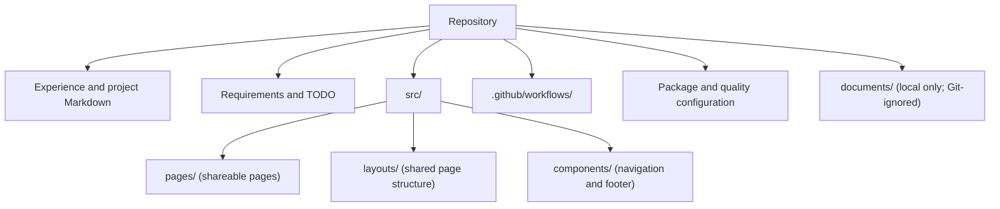

# Current Role Responsibilities

## Role Summary

I own the technical delivery and ongoing operation of Powerfleet's marketing websites and digital demand-generation systems. My work connects the website platform, campaign experiences, marketing automation, analytics, regional content, and lead-conversion workflows. I take projects from requirements and implementation through testing, release, monitoring, and documentation.

This is a working description inferred from the project documentation in this folder, not a formal company-issued job title or job description.

## Core Responsibilities

### Website and Platform Operations

- Build and maintain Joomla and YOOtheme websites, templates, child-theme overrides, modules, scripts, styles, and page-builder experiences.
- Deliver and support the main Powerfleet web estate, regional sites, campaign microsites, careers content, and supporting site utilities.
- Diagnose website, CMS, deployment, performance, and editor-workflow issues using reproducible tests and available logs.
- Maintain clear development-to-production controls: test changes in development, document evidence, preserve backups, and promote only reviewed changes.
- Coordinate hosting, CDN, DNS, and security-provider investigations when the cause lies outside the application; keep infrastructure changes with the responsible provider or administrator.

### Campaign Experiences and Lead Generation

- Build and support regional landing pages, PPC campaign pages, product and industry experiences, and interactive marketing content.
- Implement and maintain lead forms and multi-step workflows for demo requests, partner applications, referrals, customer support, careers, and incident reporting.
- Connect front-end experiences to Pardot forms and handlers, including field mappings, completion behavior, validation, regional routing, and UTM attribution.
- Develop interactive tools such as ROI and savings calculators, translating business requirements and approved assumptions into responsive, testable customer experiences.
- Maintain reusable campaign components and form utilities so new regional or product campaigns can follow established patterns.

### Marketing Automation and Data Capture

- Maintain the browser-side and server-side integrations that carry campaign and session context into form submissions.
- Preserve UTM and campaign parameters across pages and embedded forms, and support source, region, device, and referral attribution.
- Review lead-field requirements against existing CRM/Pardot fields before proposing schema changes; keep payloads and handler mappings aligned.
- Implement validation and submission safeguards, including reCAPTCHA and same-origin submission proxies where required.
- Protect personal and campaign data by limiting collection and persistence to the approved use case and avoiding exposure of credentials or sensitive session data.

### Analytics and Advertising Measurement

- Implement, test, and document Google Tag Manager and GA4 measurement for forms, resource downloads, video engagement, campaign interactions, and calculator submissions.
- Support conversion tracking across Google Ads and other advertising platforms, including event contracts, regional conversion actions, triggers, and tags.
- Validate that conversion events fire on successful outcomes, distinguish primary optimization signals from supporting reporting events, and investigate discrepancies across analytics and ad platforms.
- Maintain GTM maps and exports as auditable references, and coordinate measurement changes with campaign and agency stakeholders.
- Validate Salesforce/CRM conversion exports and prepare correctly structured files for advertising-platform imports.

### Regional Content, SEO, and Brand Transition

- Support market- and language-specific experiences, including country, currency, phone, routing, and translated-content behavior.
- Maintain regional language packs and legal-content inventories, page structures, menu associations, and publication checklists.
- Plan and validate legacy-domain migrations with approved, page-specific redirect mappings rather than speculative catch-all redirects.
- Audit URLs, redirects, tracker domains, crawlability, and related technical SEO behavior; document evidence and unresolved content decisions.
- Help migrate brand and content assets across platforms, including website video libraries and embedded media workflows.

### Privacy, Security, and Reliability

- Build privacy and consent requirements into forms, tracking, cookies, persistence, and campaign workflows, with GDPR and POPIA considered where applicable.
- Use backups, rollback references, environment separation, release notes, and focused regression checks to reduce production risk.
- Investigate security and availability incidents without making speculative production changes; preserve sanitized evidence and coordinate with the relevant security, hosting, or CDN provider.
- Keep secrets, personal information, raw logs, and sensitive exports out of tracked documentation and public repositories.

### Documentation and Operational Ownership

- Maintain repositories as practical sources of truth for implementation details, deployment steps, field mappings, testing, incidents, and open decisions.
- Turn ambiguous requests into scoped technical work, identify required business or legal approvals, and record what is verified versus pending.
- Own implementation and routine validation for the marketing systems represented here; involve agencies and external providers for findings, monitoring, or services they control.

## Representative Project Areas

These repositories illustrate the breadth of the role; they are examples, not a complete list of active services.

| Area | Representative repositories |
| --- | --- |
| Main website and platform operations | [powerfleet-cons](powerfleet-cons/README.md), [ytp-child-theme](ytp-child-theme/README.MD), [careers-powerfleet](careers-powerfleet/README.md), [mix-joomla](mix-joomla/README.md) |
| Calculators and conversion journeys | [roi-calculator-main-site](roi-calculator-main-site/README.MD), [roi-calculator-cnx](roi-calculator-cnx/README.MD), [sme-calculator](sme-calculator/README.MD) |
| Pardot, forms, and attribution | [pardot-form-scripts](pardot-form-scripts/README.md), [pardot-forms](pardot-forms/README.md), [analytics-storage-data](analytics-storage-data/README.md), [regional-sales-forms](regional-sales-forms/readme.md), [rmd-forms](rmd-forms/README.md) |
| Measurement and advertising | [powerfleet-gtm-map](powerfleet-gtm-map/README.MD), [advanced-conversion-tracking](advanced-conversion-tracking/README.md) |
| Regional campaigns and content | [mix-eu-lp](mix-eu-lp/README.md), [mix-global-gps-lp](mix-global-gps-lp/README.md), [mix-vision-standalone-za](mix-vision-standalone-za/README.md), [content-syndication](content-syndication/README.md) |
| Legal content, localization, and migration | [legal-pages-powerfleet](legal-pages-powerfleet/README.md), [language-region-packs](language-region-packs/README.md), [global-redirects](global-redirects/README.MD) |
| Reliability and media operations | [link-11-reblaze](link-11-reblaze/README.md), [vimeo-videos](vimeo-videos/README.MD) |
| Forms and supporting tools | [campaign-request-forms](campaign-request-forms/README.md), [partner-request-form-us](partner-request-form-us/README.md), [referral-link-generator](referral-link-generator/README.md), [cookie-modals](cookie-modals/README.md) |

## Scope Notes

The folder also contains legacy campaign builds, brief or placeholder READMEs, Joomla distributions, third-party assets, and experiments. Their presence is useful technical context but does not, by itself, establish that each is an actively maintained business responsibility. The core role above is based on recurring ownership patterns and the operational guidance documented across the project READMEs.

## Website project setup

The website is a minimal, static Astro starter. Its content and design are
placeholders; see [requirements.md](requirements.md) for the agreed baseline and
open decisions.

### Next: product and UI

Build a lightweight, interactive experience for recruiters and other potential
hirers, with shareable URLs and SPA-style navigation. Start with approved
content and a clear primary action, then develop the UI, browser-preferred light
and dark themes, and self-hosted typography. See [TODO.md](TODO.md) for the
product tasks and acceptance checks.

### Repository structure

The existing Markdown files describe experience and provide project context.
They are reference material, not automatically published website content. The
current website contains placeholder home, about, experience, skills, and
not-found pages.

```text
.
├── README.MD                 Project context and setup
├── responsibilities.md       Experience reference
├── requirements.md           Product and quality requirements
├── TODO.md                   Product and UI tasks
├── inspiration.md, stack.md  Design and technology references
├── astro.config.mjs          Production URL and URL format
├── src/pages/                Home, about, experience, skills, and 404 pages
├── src/layouts/              Shared page structure and client navigation
├── src/components/           Shared navigation and footer
├── tests/                    Generated-page checks
├── .github/workflows/        Quality checks and deployment
├── package.json              Scripts and dependencies
└── documents/                Local reference files; ignored by Git
```



As the site grows, use the following structure. `pages/`, `layouts/`, and
`components/` exist; the other folders are **proposed** and should be created
only when needed:

```text
src/
├── pages/        Site entry points
├── components/   Reusable UI and interactive components
├── layouts/      Shared page structure
├── content/      Approved website content
├── styles/       Shared styles and theme tokens
└── assets/       Images and other assets processed by Astro
public/           Assets served as-is, such as self-hosted fonts
```

Start by reviewing the existing Markdown and selecting what is suitable for the
site. Keep approved content separate from UI where practical. The content format
or source can change later; do not assume every repository Markdown file should
be published or introduce a content service until it is needed.

### How the site is built and deployed

```mermaid
flowchart LR
    Docs["Existing Markdown<br/>experience references"]
    Review["Review and approve<br/>content (planned)"]
    Content["Website content<br/>(planned)"]
    Page["Astro pages<br/>current placeholders"]
    Build["Astro static build"]
    Checks["Page tests and<br/>Lighthouse quality checks"]
    Deploy["Cloudflare Pages"]
    Site["Recruiters and<br/>potential hirers"]

    Docs -.-> Review
    Review -.-> Content
    Content -.-> Page
    Page --> Build --> Checks --> Deploy --> Site
```



Dotted lines are future work, not an existing content pipeline. For a push to
`main`, GitHub Actions runs the build and checks before deploying. The diagram
renders on GitHub and in Markdown viewers with Mermaid support; it does not add
a library or runtime request to the website.

Use Node.js 22.23.4 or newer on a supported even-numbered release, then run:

```sh
npm ci
npm run dev
```

Run `npm run build` to generate the static site in `dist/`, and
`npm run preview` to preview the build locally.

### Navigation and search

Astro generates separate HTML pages for `/`, `/about/`, `/experience/`, and
`/skills/`. To add a page, create it in `src/pages/` using `SiteLayout` and add
it to the list in `src/components/SiteNav.astro`.
Its built-in client router provides SPA-style navigation when JavaScript is
available; ordinary links still work without it. The generated `404.html`
supplies a not-found page.

The navigation links are defined once in `src/components/SiteNav.astro` and
used by both the header and the footer. The current
page's item is shown as plain, emphasized text with `aria-current="page"`
rather than a link, so it cannot be clicked again and is skipped when tabbing.

`src/components/SiteFooter.astro` appears on every page through the shared
layout. It repeats the navigation and shows the year, Gqeberha, South Africa,
and South Africa Standard Time (SAST, UTC+2). The year is set when the site is
built, so it updates on the first deployment of a new year.

Each placeholder page has its own title, description, and canonical URL, but is
temporarily marked `noindex`: it is not ready to appear in search results.
Approve real content before removing that instruction and creating a sitemap.
The canonical origin is currently `https://dfpf-26-27.pages.dev`; update
`astro.config.mjs` if the production domain changes.

Local implementation checks: the build, generated-page tests, and Lighthouse
checks passed. Browser checks covered client navigation and history, direct
loading, navigation without JavaScript, and widths of 360 px and 1280 px.
Deployed 2026-11-24 via the
[quality-checked workflow](https://github.com/6210/dfpf-26-27/actions/runs/45345512289):
`/` and `/experience/` return 200, and unknown URLs return the 404 page with a
404 status on Cloudflare Pages.

### Light and dark theme

The site starts in the visitor's system light or dark preference. The theme
button in the header names the mode it switches to: **Dark mode** while the
site is light and **Light mode** while it is dark. The choice is saved in the
browser's `localStorage` and applies across pages and later visits. A small
inline script in the page head sets the theme before content appears, so there
is no flash of the wrong theme. Without JavaScript, the site follows the system
preference and the button is hidden. Colors use CSS `light-dark()` with
placeholder values until the visual design is chosen.

Local checks (2026-11-24): build, page tests, and Lighthouse passed
(accessibility 100). Browser checks covered light and dark preferences,
toggling by mouse and keyboard, persistence across client navigation, back
navigation, and reload, and a 360 px width. Live following of a system
preference change could not be confirmed in the test browser; check it on a
real device.

Skills page and navigation update (2026-11-24, deployed in
[this workflow run](https://github.com/6210/dfpf-26-27/actions/runs/45350501851)): build, page
tests, and Lighthouse passed for all four pages. Browser checks confirmed the
current nav item is not a link on each page, the theme button label switches
between **Dark mode** and **Light mode**, and the layout fits at 360 px. Page
transition errors appeared only in a hidden test tab, where browsers cancel
view transitions; a visible Chrome session showed none. A missing favicon
returns 404 (pre-existing; see TODO).

Footer update (2026-11-24, not yet deployed): build, page tests, and Lighthouse
passed for all pages. Browser checks covered footer navigation and current-page
state after client navigation, dark mode, and a 360 px width.

### Deploy to Cloudflare Pages

The existing Cloudflare Pages project is connected to this repository. The
intended deployment flow is a push to `main`: GitHub Actions builds the site,
runs the quality checks, and deploys to Cloudflare only if they pass.

One-time setup:

1. In Cloudflare Pages project settings, disable automatic production and preview
   branch deployments. Otherwise Cloudflare can deploy independently of the
   quality checks.
2. Create a Cloudflare API token with account-level **Cloudflare Pages: Edit**
   permission, scoped to the project's account.
3. In GitHub repository settings, add the Actions secrets
   `CLOUDFLARE_API_TOKEN` and `CLOUDFLARE_ACCOUNT_ID`. Never commit these values.
4. Push to `main`, check the **Website quality** run in GitHub Actions, and
   verify the resulting `pages.dev` site.

Until these settings are in place and the workflow has successfully deployed,
the automatic quality gate is not active.

Setup completed (2026-11-23): Cloudflare automatic production and preview
deployments were disabled, the Pages Edit token and GitHub secrets were added,
and the workflow was pushed directly to `main`. The
[first quality-checked deployment](https://github.com/6210/dfpf-26-27/actions/runs/45232769051)
passed, and the live page was verified. Do not record secret values in this file.

The site is static, so no Cloudflare adapter or Matter.js dependency is needed
for this initial page. Connecting a repository and deploying require access to a
Cloudflare account.

The initial `Hello World` page scored 100 for mobile performance in Lighthouse
13.6.0 against a local production preview on 2026-11-23 (Headless Chrome 157 on
macOS). Repeat the audit against the deployed site before launch.

### Website quality checks

With Chrome or Chromium installed, run `npm run build`, `npm test`, and
`npm run quality`. Lighthouse checks every discovered static page using its
mobile settings. The check fails if performance or accessibility scores are
below 90, the viewport check fails, or the initial script transfer exceeds
100 KiB. Inline scripts are part of the HTML response and are not included in
the script transfer budget. Keyboard, reduced-motion, and responsive-layout
checks still require manual testing.

GitHub Actions runs the same check for pull requests and pushes to `main`.
Once the deployment setup above is complete, a failed check prevents that
workflow from deploying. Manual checks are still required before pushing.

### Direct dependencies

| Dependency | Purpose | License | Source |
| --- | --- | --- | --- |
| Astro | Static website framework | MIT | https://github.com/withastro/astro |
| Lighthouse CI | Build quality checks | Apache-2.0 | https://github.com/GoogleChrome/lighthouse-ci |

See [dependency-licenses.md](dependency-licenses.md) for the locked dependency
inventory and licensing review notes. Update the inventory and review the built
output when dependencies or assets change.

The workflow also uses [checkout](https://github.com/actions/checkout) and
[setup-node](https://github.com/actions/setup-node) (MIT), plus
[wrangler-action](https://github.com/cloudflare/wrangler-action) and
[Wrangler](https://github.com/cloudflare/workers-sdk) (MIT OR Apache-2.0) for
deployment. These tools run in GitHub Actions and are not shipped to visitors.
