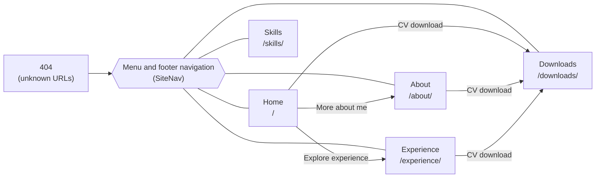

# Site flow

How the pages, components, and content fit together. Update these diagrams
whenever a page, component, or content source is added, removed, or rewired.
The diagrams render on GitHub and in Markdown viewers with Mermaid support.

## Pages and navigation

Every page shares the header (scroll spy and full-screen menu) and the footer,
so any page can reach any other. The scroll spy links jump between sections on
the current page; on large screens with a mouse or trackpad they sit in a rail
fixed at the centre right instead of the header.

## Components and content

`SiteLayout` wraps every page. Pages add their own components and read content
through the helpers in `src/lib/content.ts`.

```mermaid
flowchart TD
    subgraph Pages["src/pages"]
        index["index.astro"]
        about["about.astro"]
        experience["experience.astro"]
        skills["skills.astro"]
        downloads["downloads.astro"]
        notfound["404.astro"]
    end

    subgraph Layout["src/layouts"]
        SiteLayout["SiteLayout.astro<br/>head, theme, fonts,<br/>page transitions"]
    end

    subgraph Components["src/components"]
        SiteHeader["SiteHeader.astro<br/>name, scroll spy,<br/>theme toggle, menu"]
        SiteNav["SiteNav.astro<br/>page links"]
        ThemeToggle["ThemeToggle.astro<br/>sun/moon icon button"]
        SiteFooter["SiteFooter.astro"]
        GetInTouch["GetInTouch.astro<br/>email and phone"]
        CvDownload["CvDownload.astro"]
        AboutSummary["AboutSummary.astro<br/>home About section,<br/>photo placeholder"]
        PageHero["PageHero.astro<br/>h1, lead, animation beside it"]
        Physics["PhysicsPlaceholder.astro<br/>(Matter.js, lazy-loaded)"]
        Timeline["Timeline.astro<br/>one page section: the whole timeline"]
        RoleEntry["RoleEntry.astro<br/>one timeline chapter: a role and its areas"]
        Recommendations["Recommendations.astro<br/>quotes, placeholders labelled"]
        AreaIcon["AreaIcon.astro<br/>area icon in the accent colour"]
        AreaBadge["AreaBadge.astro<br/>morphing area badge<br/>(flubber, lazy-loaded)"]
        DotGrid["DotGrid.astro<br/>fixed dot grid that<br/>moves away from the cursor,<br/>softer on the left"]
    end

    subgraph Content["Content"]
        lib["src/lib/content.ts<br/>getProfile, getRoles, getPlatforms,<br/>getRecommendations, getCvFiles"]
        icons["src/lib/area-icons.ts<br/>accents and Phosphor icon paths"]
        profile[("src/content/profile.json")]
        roles[("src/content/roles/*.md")]
        recs[("src/content/recommendations.json")]
        cvfiles[("CV files in public/")]
    end

    index & about & experience & skills & downloads & notfound --> SiteLayout
    SiteLayout --> SiteHeader & GetInTouch & SiteFooter & AreaBadge & DotGrid
    SiteHeader & SiteFooter --> SiteNav
    SiteHeader --> ThemeToggle

    index & about & experience --> CvDownload
    index --> AboutSummary
    index & about & experience & skills & downloads & notfound --> PageHero
    PageHero --> Physics
    experience --> Timeline & RoleEntry & Recommendations
    Timeline -- "slot" --> RoleEntry
    skills --> AreaIcon
    AreaIcon & AreaBadge -. "icon paths" .-> icons
    experience & skills -. "data-morph targets" .-> AreaBadge

    index & skills & SiteHeader & GetInTouch & AboutSummary -. "getProfile" .-> lib
    skills -. "getPlatforms" .-> lib
    experience -. "getRoles" .-> lib
    experience & Recommendations -. "getRecommendations" .-> lib
    downloads & CvDownload -. "getCvFiles" .-> lib

    lib --> profile & roles & recs
    lib -. "checked at build" .-> cvfiles
```

Solid arrows mean "renders"; dotted arrows mean "reads content from".
